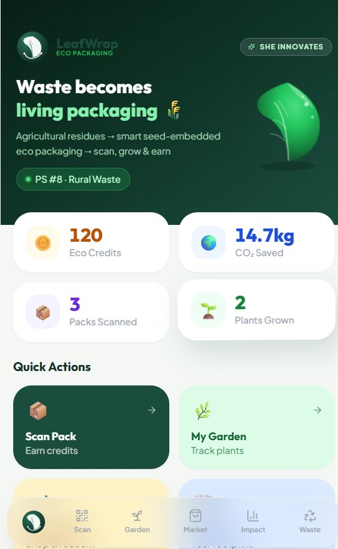
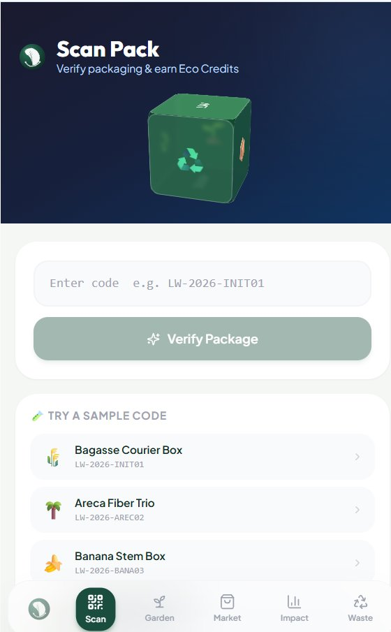
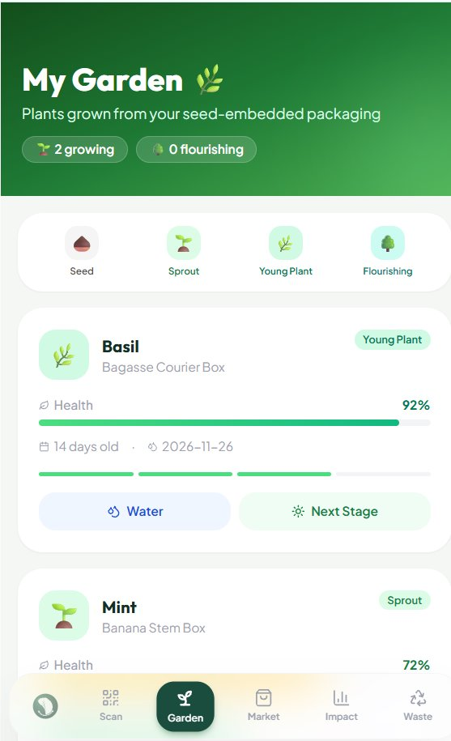
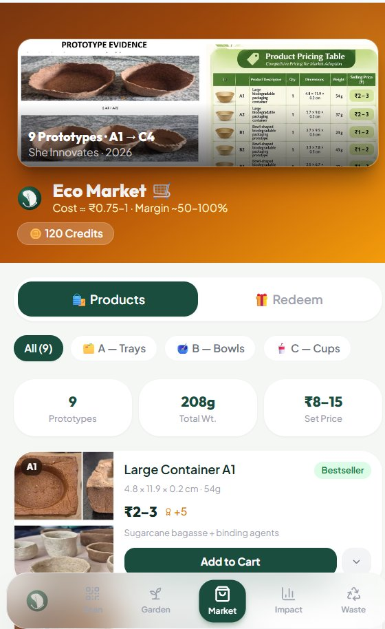
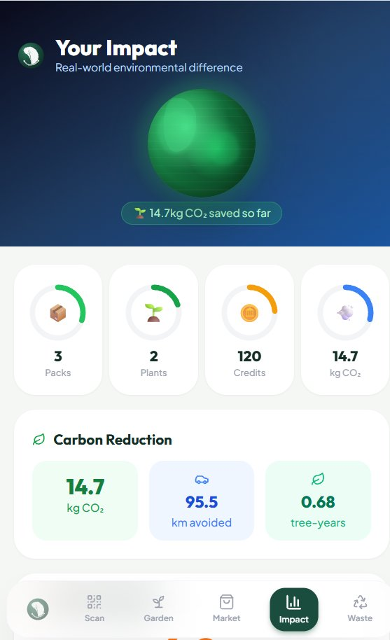
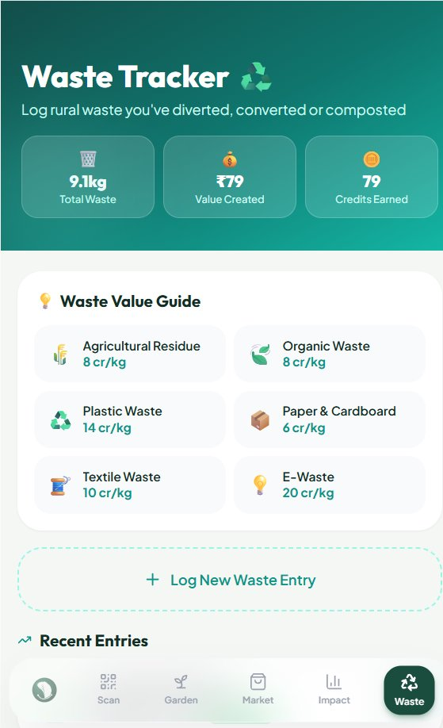
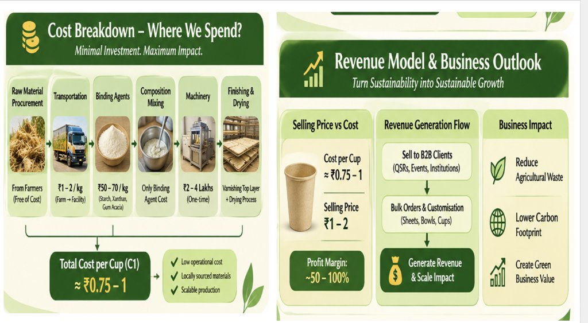

# 🌿 LeafWrap — Eco-Friendly Smart Packaging & Reward System

> **Team:** She Innovates &nbsp;|&nbsp; **Problem Statement #8:** Value Addition to Rural Waste for Better Waste Management

<div align="center">

[](https://courageous-crostata-752684.netlify.app/)
[](https://react.dev/)
[](https://vitejs.dev/)
[](https://tailwindcss.com/)

</div>

---

## 📱 App Screenshots

<div align="center">

| Home | Scan | Garden |
|:---:|:---:|:---:|
|  |  |  |

| Market | Impact | Waste Tracker |
|:---:|:---:|:---:|
|  |  |  |

</div>

---

## 🧩 Problem Statement

**Value Addition to Rural Waste for Better Waste Management**

> Rural areas generate various types of waste — agricultural residues, organic waste, plastics, and other discarded materials — which often remain underutilised due to a lack of proper processing facilities, recycling mechanisms, and value-recovery methods. Improper waste handling leads to environmental pollution, resource wastage, and missed economic opportunities.

---

## 💡 Our Solution — The LeafWrap Ecosystem

LeafWrap transforms agricultural waste into **smart, seed-embedded biodegradable packaging**, then connects consumers back to nature via a mobile app — creating a full circular loop: **Waste → Product → Use → Soil → Growth**.

### The App + QR Ecosystem

<div align="center">
  
  <br/><sub><em>Scan & Verify → Trace the agricultural waste source → Engage & Earn Eco Credits</em></sub>
</div>

---

## 🏭 How the Product is Made

<div align="center">
  
  <br/><sub><em>Raw Material → Material Preparation → Dry & Optimise → Measure → Heat-Press Moulding → Prototype</em></sub>
</div>

**Feedstocks used:**
- 🌾 **Sugarcane Bagasse** — from regional sugar mills
- 🌾 **Paddy / Rice Straw** — post-harvest Kharif residue
- 🌴 **Areca Palm Fronds** — naturally shed, coastal Karnataka
- 🍌 **Banana Stem Fiber** — combined with bio-carbon
- 🍄 **Agricultural Bran + Mycelium** — myco-composite foam

---

## 🧪 Prototype Evidence

<div align="center">
  
  <br/><br/>
  
  <br/><sub><em>All 9 prototypes (A1–C4) with real dimensions & competitive pricing (₹0.75–₹15 per unit)</em></sub>
</div>

---

## 🌱 From Packaging to Soil

<div align="center">
  
  <br/><sub><em>Placed in Soil → Exposed to Moisture → Breakdown Observed → Plant Emergence</em></sub>
</div>

---

## 💰 Business Model

<div align="center">
  
  <br/><sub><em>Cost per unit ≈ ₹0.75–1 &nbsp;|&nbsp; Selling price ₹1–2 &nbsp;|&nbsp; Profit margin ~50–100%</em></sub>
</div>

---

## ✨ App Features

| Feature | Description |
|---|---|
| **🏠 Home Dashboard** | Live Eco Credits, CO₂ saved, packs scanned, plants grown |
| **📦 QR Scanner** | Enter serial code → verify packaging → earn Eco Credits instantly |
| **🌱 Plant Garden** | 4-stage growth tracker (Seed → Sprout → Young Plant → Flourishing) |
| **🛒 Eco Market** | All 9 prototypes (A1–C4) with real photos, pricing & cart |
| **🌍 Impact Dashboard** | 3D Earth globe, CO₂ charts, burn prevention calculator, milestones |
| **♻️ Waste Tracker** | Log rural waste by type, earn credits per kg, track value created |

---

## 🛠️ Tech Stack

| Technology | Purpose |
|---|---|
| **React 18** | UI framework |
| **Vite 6** | Build tool & dev server |
| **TailwindCSS 3** | Utility-first styling |
| **React Router v6** | Client-side navigation |
| **Lucide React** | Icons |
| **Context API** | Global state |
| **Netlify** | Hosting & CI/CD |

---

## 🚀 Getting Started

```bash
git clone https://github.com/tahiyatarannum09/Sheinnovates.git
cd Sheinnovates
npm install
npm run dev        # → http://localhost:5173
npm run build      # Production build
```

---

## 📁 Project Structure

```
Sheinnovates/
├── public/images/          # App screenshots + PPT photos
├── src/
│   ├── contexts/           # Global state (EcoContext)
│   ├── components/ui/      # BottomNav, LeafWrapLogo
│   └── pages/
│       ├── HomePage.jsx
│       ├── ScanPage.jsx
│       ├── GardenPage.jsx
│       ├── MarketPage.jsx
│       ├── ImpactPage.jsx
│       └── WasteTrackerPage.jsx  🆕
├── netlify.toml
└── package.json
```

---

## 👩‍💻 Team — She Innovates

> *Built with 💚 at the She Innovates Hackathon 2026 · Problem Statement #8*

---

<div align="center">
  <strong>🌿 LeafWrap × She Innovates — Turning Agricultural Waste into Worth, One Package at a Time 🌱</strong>
</div>
