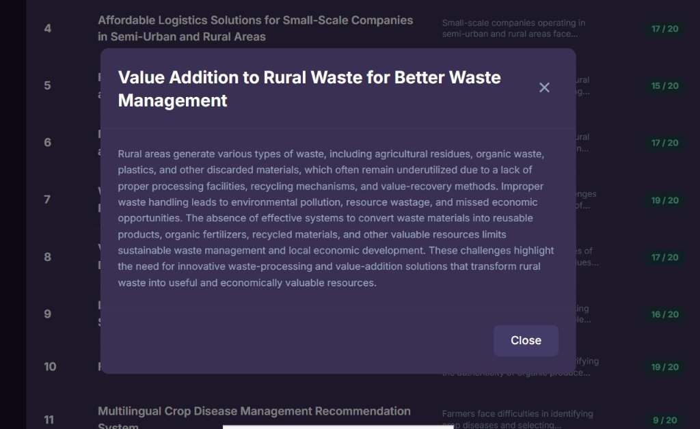

# 🌿 LeafWrap — Eco-Friendly Smart Packaging & Reward System

> **Team:** She Innovates | **Hackathon:** 2026 | **Category:** Rural Waste Management & Sustainability

<div align="center">
  

  [](https://courageous-crostata-752684.netlify.app/)
  [](https://react.dev/)
  [](https://vitejs.dev/)
  [](https://tailwindcss.com/)
</div>

---

## 🧩 Problem Statement

**Value Addition to Rural Waste for Better Waste Management**

> Rural areas generate various types of waste, including agricultural residues, organic waste, plastics, and other discarded materials, which often remain underutilized due to a lack of proper processing facilities, recycling mechanisms, and value-recovery methods. Improper waste handling leads to environmental pollution, resource wastage, and missed economic opportunities. The absence of effective systems to convert waste materials into reusable products, organic fertilizers, recycled materials, and other valuable resources limits sustainable waste management and local economic development. These challenges highlight the need for innovative waste-processing and value-addition solutions that transform rural waste into useful and economically valuable resources.

<div align="center">
  
  <p><em>Problem Statement — She Innovates Hackathon 2026</em></p>
</div>

---

## 💡 Our Solution — LeafWrap

LeafWrap is a **mobile-first Progressive Web App** that transforms rural agricultural waste into smart, seed-embedded eco packaging and builds a circular economy through QR scanning, Eco Credits rewards, plant growth tracking, and direct impact dashboards.

### How LeafWrap Addresses the Problem

| Rural Waste Type | LeafWrap Solution | Outcome |
|---|---|---|
| Sugarcane Bagasse | Molded into delivery boxes | Replaces plastic; seeds grow herbs |
| Rice Straw | Pressed into biodegradable dishes | Prevents field burning; compostable |
| Areca Palm Fronds | Shaped into fiber packaging | Diverts waste; supports local artisans |
| Banana Stem Fiber | Combined with bio-carbon | Creates durable packaging; carbon offset |
| Agricultural Bran | Grown with mycelium | Mushroom mycelium foam packaging |

---

## ✨ Features

### 🔑 Core Features (from Deployed Site)
- **QR Code Scanning** — Scan seed-embedded smart packaging to verify authenticity
- **Eco Credits System** — Earn and spend credits for eco actions
- **Plant Growth Tracker** — Follow your packaging seed from soil to harvest
- **Eco Market** — Browse products made from rural agricultural waste
- **CO₂ Impact Dashboard** — Live carbon savings tracker

### 🆕 Additional Features (Added by She Innovates)

#### ♻️ Waste Tracker *(New Page)*
- Log rural waste diverted or composted by type (agricultural residue, plastic, organic, textile, e-waste)
- Earn Eco Credits per kg of waste logged
- Track processing status: Processed / Composted / Recycled
- Running totals: total kg diverted, rupee value created, credits earned

#### 🌍 Enhanced Impact Dashboard *(Extended)*
- Stubble burn prevention calculator (kg of crop residue diverted from field burning)
- Waste material composition breakdown with visual progress bars
- Achievement milestones: First Scan, 5 Packs, Eco Champion, etc.
- Equivalent metrics: car travel avoided (km), tree-year equivalents

#### 🛒 Eco Market with Credit Redemption *(Extended)*
- Full product catalog with Eco Credits earned on each purchase
- Credit-to-coupon redemption system
- Product material sourcing info (which rural waste it uses)

#### 🌱 Interactive Garden *(Extended)*
- Multi-stage plant life cycle (Seed → Sprout → Young Plant → Flourishing)
- Watering with health percentage tracking
- Add custom plants from any LeafWrap package

---

## 🛠️ Tech Stack

| Technology | Purpose |
|---|---|
| **React 18** | UI framework with hooks |
| **Vite 6** | Build tool & dev server |
| **TailwindCSS 3** | Utility-first styling |
| **React Router v6** | Client-side navigation |
| **Lucide React** | Icon set |
| **Context API** | Global state (Eco Credits, CO₂, etc.) |
| **Netlify** | Hosting & deployment |

---

## 🚀 Getting Started

### Prerequisites
- Node.js 18+
- npm or yarn

### Installation

```bash
# Clone the repository
git clone https://github.com/tahiyatarannum09/Sheinnovates.git
cd Sheinnovates

# Install dependencies
npm install

# Start development server
npm run dev
```

The app will be available at `http://localhost:5173`

### Build for Production

```bash
npm run build
```

Built files will be in the `dist/` folder.

### Deploy to Netlify

```bash
# Install Netlify CLI
npm install -g netlify-cli

# Deploy
netlify deploy --prod --dir=dist
```

Or simply push to this repo — Netlify auto-deploys from `main` branch using `netlify.toml`.

---

## 📁 Project Structure

```
Sheinnovates/
├── public/
│   └── images/
│       └── problem-statement.jpg   # PPT screenshot
├── src/
│   ├── contexts/
│   │   └── EcoContext.jsx          # Global state: credits, CO₂, plants
│   ├── components/
│   │   └── ui/
│   │       └── BottomNav.jsx       # Bottom navigation bar
│   ├── pages/
│   │   ├── HomePage.jsx            # Dashboard with stats & quick actions
│   │   ├── ScanPage.jsx            # QR code / serial code scanner
│   │   ├── GardenPage.jsx          # Plant growth tracker
│   │   ├── MarketPage.jsx          # Eco product store + credit redemption
│   │   ├── ImpactPage.jsx          # CO₂ & environmental impact dashboard
│   │   └── WasteTrackerPage.jsx    # 🆕 Rural waste logging feature
│   ├── App.jsx                     # Router setup
│   ├── main.jsx                    # React entry point
│   └── index.css                   # Tailwind + global styles
├── index.html
├── vite.config.js
├── tailwind.config.js
├── netlify.toml
└── package.json
```

---

## 🌍 Environmental Impact

LeafWrap products are sourced from and designed to address:

- **30%** Sugarcane Bagasse (sugar mill residue)
- **25%** Rice Straw (post-harvest kharif residue)
- **20%** Areca Palm Fronds (shed naturally)
- **15%** Banana Stem Fiber
- **10%** Other agricultural residues

Each package prevents **~2.3 kg** of agricultural waste from being burned in fields.

---

## 👩‍💻 Team — She Innovates

| Member | Role |
|---|---|
| **Team Lead** | Product & UX Design |
| **Developer 1** | React Frontend |
| **Developer 2** | Backend & Logic |
| **Designer** | Branding & UI |

> *Built with 💚 at the She Innovates Hackathon 2026*

---

## 📄 License

MIT License — feel free to fork, adapt, and build upon this for your own sustainability projects.

---

<div align="center">
  <strong>🌿 LeafWrap × She Innovates — Turning Waste into Worth 🌱</strong>
</div>
