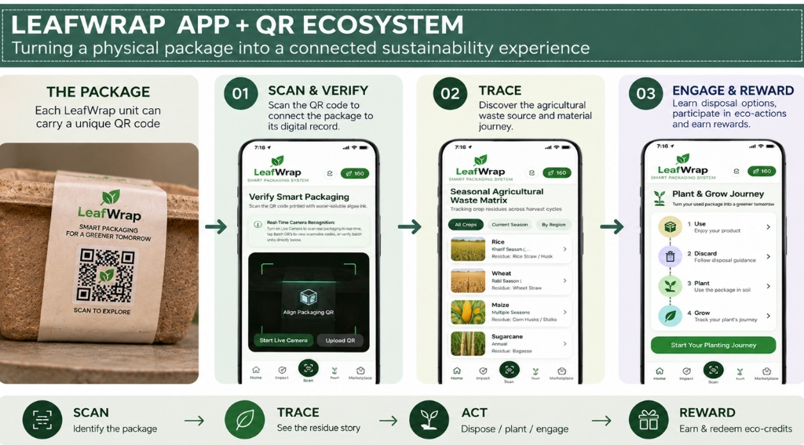
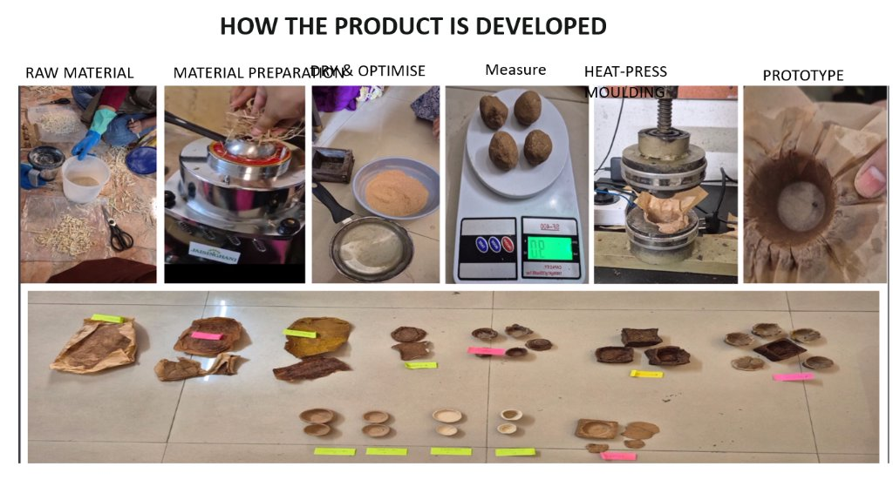
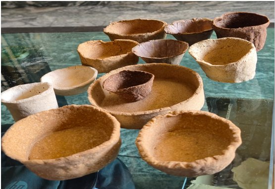
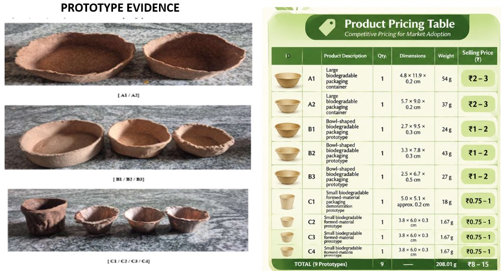
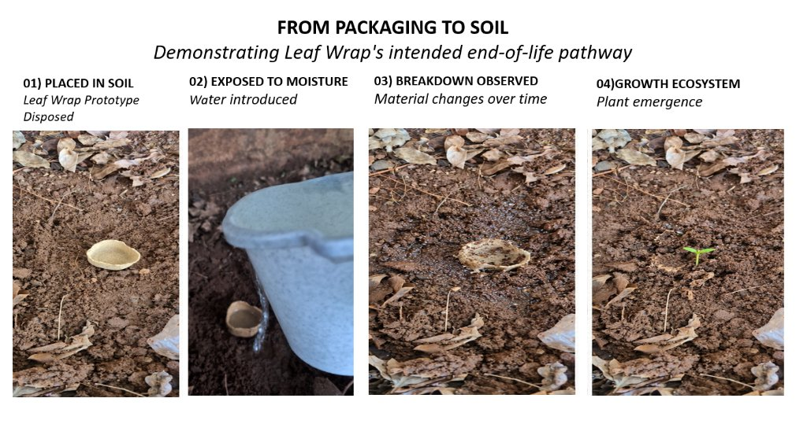

# 🌿 LeafWrap — Eco-Friendly Smart Packaging & Reward System

> **Team:** She Innovates &nbsp;|&nbsp; **Problem Statement #8:** Value Addition to Rural Waste for Better Waste Management

<div align="center">

[](https://courageous-crostata-752684.netlify.app/)
[](https://react.dev/)
[](https://vitejs.dev/)
[](https://tailwindcss.com/)

</div>

---

## 🧩 Problem Statement

**Value Addition to Rural Waste for Better Waste Management**

> Rural areas generate various types of waste — agricultural residues, organic waste, plastics, and other discarded materials — which often remain underutilised due to a lack of proper processing facilities, recycling mechanisms, and value-recovery methods. Improper waste handling leads to environmental pollution, resource wastage, and missed economic opportunities.

---

## 💡 Our Solution — The LeafWrap Ecosystem

LeafWrap transforms agricultural waste into **smart, seed-embedded biodegradable packaging**, then connects consumers back to nature via a mobile app — creating a full circular loop: **Waste → Product → Use → Soil → Growth**.

### The App + QR Ecosystem

<div align="center">
  
  <br/><sub><em>Each LeafWrap unit carries a unique QR code — scan to verify, trace the agricultural waste source, and earn eco-rewards</em></sub>
</div>

**The 3-step consumer journey:**

| Step | Action | What Happens |
|:---:|---|---|
| 01 | **Scan & Verify** | QR connects the physical package to its digital record |
| 02 | **Trace** | Discover the agricultural waste source and material journey |
| 03 | **Engage & Reward** | Plant it in soil, track growth, earn & redeem Eco Credits |

---

## 🏭 How the Product is Made

LeafWrap packaging starts on the farm as waste and ends in the earth as soil — here's the full journey from raw residue to finished prototype:

<div align="center">
  
  <br/><sub><em>Raw Material → Material Preparation → Dry & Optimise → Measure → Heat-Press Moulding → Prototype</em></sub>
</div>

**Feedstocks used:**
- 🌾 **Sugarcane Bagasse** — from regional sugar mills
- 🌾 **Paddy / Rice Straw** — post-harvest Kharif residue
- 🌴 **Areca Palm Fronds** — naturally shed, coastal Karnataka
- 🍌 **Banana Stem Fiber** — combined with bio-carbon
- 🍄 **Agricultural Bran + Mycelium** — myco-composite foam

---

## 🧪 Prototype Evidence

Nine validated prototypes — from large biodegradable containers down to small cups — all made from rural agricultural waste.

<div align="center">
  
  <br/><br/>
  
  <br/><sub><em>Prototype catalogue (A1–C4) with dimensions, weight, and competitive pricing (₹0.75–₹15 per unit)</em></sub>
</div>

---

## 🌱 From Packaging to Soil

The end-of-life of every LeafWrap unit is designed to be a beginning — the package biodegrades and seeds germinate:

<div align="center">
  
  <br/><sub><em>Placed in Soil → Exposed to Moisture → Breakdown Observed → Growth Ecosystem (plant emergence)</em></sub>
</div>

---

## 💰 Business Model

<div align="center">
  
  <br/><sub><em>Cost per unit ≈ ₹0.75–1 &nbsp;|&nbsp; Selling price ₹1–2 &nbsp;|&nbsp; Profit margin ~50–100%</em></sub>
</div>

**Revenue flow:**
- Raw materials sourced from farmers at ₹1–2/kg (or free of cost)
- Binding agents: starch, xanthan, gum acacia (₹50–70/kg)
- Machinery: one-time ₹2–4 Lakhs
- **B2B sales** to QSRs, events, institutions — bulk orders & customisation
- **Impact:** Reduce agricultural waste · Lower carbon footprint · Create green business value

---

## ✨ App Features

### 🔑 Core Features
| Feature | Description |
|---|---|
| **QR Code Scanner** | Scan seed-embedded packaging to verify authenticity & earn credits |
| **Eco Credits System** | Earn and spend credits for every eco action |
| **Plant Growth Tracker** | Follow your packaging seed from soil to harvest across 4 stages |
| **Eco Market** | Browse & buy products made from rural agricultural waste |
| **CO₂ Impact Dashboard** | Live carbon savings tracker with real-world equivalents |

### 🆕 Additional Features (Added by She Innovates)

#### ♻️ Waste Tracker *(New Page)*
- Log rural waste diverted or composted by type (agricultural residue, plastic, organic, textile, e-waste)
- Earn Eco Credits per kg of waste logged
- Track processing status: Processed / Composted / Recycled
- Running totals: total kg diverted, rupee value created, credits earned

#### 🌍 Enhanced Impact Dashboard
- Stubble burn prevention calculator
- Waste material composition breakdown with visual progress bars
- Achievement milestones: First Scan → Eco Champion
- Equivalent metrics: car travel avoided (km), tree-year equivalents

---

## 🛠️ Tech Stack

| Technology | Purpose |
|---|---|
| **React 18** | UI framework with hooks |
| **Vite 6** | Build tool & dev server |
| **TailwindCSS 3** | Utility-first styling |
| **React Router v6** | Client-side navigation |
| **Lucide React** | Icon library |
| **Context API** | Global state (Eco Credits, CO₂, waste log) |
| **Netlify** | Hosting & continuous deployment |

---

## 🚀 Getting Started

```bash
# Clone the repository
git clone https://github.com/tahiyatarannum09/Sheinnovates.git
cd Sheinnovates

# Install dependencies
npm install

# Start development server
npm run dev
# → http://localhost:5173

# Build for production
npm run build
```

---

## 📁 Project Structure

```
Sheinnovates/
├── public/images/                    # All PPT & prototype screenshots
│   ├── app-qr-ecosystem.jpg          # LeafWrap App flow diagram
│   ├── product-development-process.jpg
│   ├── prototypes-collection.jpg
│   ├── prototype-evidence-pricing.jpg
│   ├── packaging-to-soil.jpg
│   ├── cost-revenue-model.jpg
│   └── problem-statement.jpg
├── src/
│   ├── contexts/EcoContext.jsx       # Global state
│   ├── components/ui/BottomNav.jsx   # Bottom navigation
│   └── pages/
│       ├── HomePage.jsx              # Dashboard
│       ├── ScanPage.jsx              # QR scanner
│       ├── GardenPage.jsx            # Plant tracker
│       ├── MarketPage.jsx            # Eco store
│       ├── ImpactPage.jsx            # CO₂ dashboard
│       └── WasteTrackerPage.jsx      # 🆕 Waste logging
├── netlify.toml
└── package.json
```

---

## 👩‍💻 Team — She Innovates

> *Built with 💚 at the She Innovates Hackathon 2026 · Problem Statement #8: Value Addition to Rural Waste*

---

<div align="center">
  <strong>🌿 LeafWrap × She Innovates — Turning Agricultural Waste into Worth, One Package at a Time 🌱</strong>
</div>
